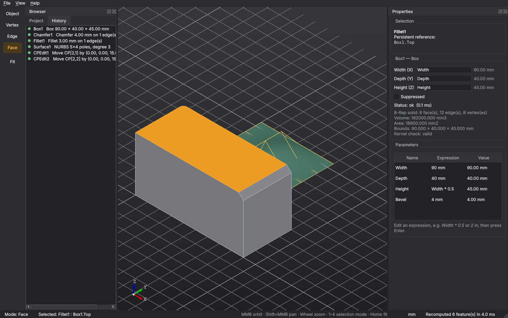

# HybridCAD

A native Windows parametric CAD application combining Blender-like
interaction, Plasticity-inspired direct and NURBS modelling, and fully editable
parametric history, with mesh-to-CAD reverse engineering.

**Status: Phase 0 — architecture and technical proof of concept.** Not a usable
CAD application yet. See [docs/PHASE0_REPORT.md](docs/PHASE0_REPORT.md).



## Documentation

| Document | Content |
|---|---|
| [PHASE0_REPORT](docs/PHASE0_REPORT.md) | Results of Phase 0, decisions, test results, risks |
| [PRODUCT_BRIEF](docs/PRODUCT_BRIEF.md) | Vision, principles, non-goals, open owner decisions |
| [ARCHITECTURE](docs/ARCHITECTURE.md) | Layers, document model, recompute, topological naming |
| [TECH_DECISIONS](docs/TECH_DECISIONS.md) | ADR log and risk register |
| [ROADMAP](docs/ROADMAP.md) | Phases 0–10 and Phase 1 plan |
| [LICENCES](docs/LICENCES.md) | Dependency and licence review |
| [TEST_STRATEGY](docs/TEST_STRATEGY.md) | Test levels, CI |
| [NURBS_ARCHITECTURE](docs/NURBS_ARCHITECTURE.md) | NURBS representation and editing |
| [MESH_TO_CAD](docs/MESH_TO_CAD.md) | Reverse-engineering pipeline |
| [UX_DESIGN](docs/UX_DESIGN.md) | Layout, interaction, visual design |

## Building

Requirements: CMake ≥ 3.21, a C++20 compiler, Open CASCADE Technology
(7.6–7.9 tested), Qt 6 (Widgets), GoogleTest.

### Linux (Ubuntu 24.04)

```bash
sudo apt install cmake ninja-build g++ libocct-*-dev qt6-base-dev libgtest-dev \
  libgl-dev libglu1-mesa-dev libfontconfig1-dev libtbb-dev xvfb
cmake -S . -B build -G Ninja -DCMAKE_BUILD_TYPE=RelWithDebInfo
cmake --build build
ctest --test-dir build --output-on-failure      # includes UI smoke test via xvfb-run
./build/src/HybridCAD
```

### Windows (MSVC 2022)

The CI recipe (`.github/workflows/ci.yml`) uses conda-forge binaries:

```powershell
micromamba create -n hcad -c conda-forge occt=7.9 qt6-main=6.8 gtest cmake ninja
micromamba activate hcad
# from a "x64 Native Tools Command Prompt for VS 2022"
cmake -S . -B build -G Ninja -DCMAKE_BUILD_TYPE=Release `
  -DCMAKE_PREFIX_PATH="$env:CONDA_PREFIX\Library" -DHCAD_RUNTIME_DIRS="$env:CONDA_PREFIX\Library\bin" `
  -DCMAKE_INSTALL_PREFIX="$pwd\dist\HybridCAD-PoC"
cmake --build build
ctest --test-dir build -E ui_smoke
cmake --install build      # portable folder with required DLLs
```

A ready-made portable build is attached to each CI run as the
`HybridCAD-PoC-windows-x64` artifact. There is no installer yet (Phase 1).

## Using the proof of concept

- 1 / 2 / 3 / 4: Object / Vertex / Edge / Face selection. Click to select.
- Middle mouse: orbit; Shift+Middle or right drag: pan; wheel: zoom; Home: fit.
- Edit parameters (e.g. `Width` → `90 mm` or `Height` → `Width * 0.5`) in the
  Parameters table, or a feature's fields after selecting it in History.
- Right-click a History item: suppress, roll back, roll to end.
- File → Import Mesh Reference (STL, OBJ).
