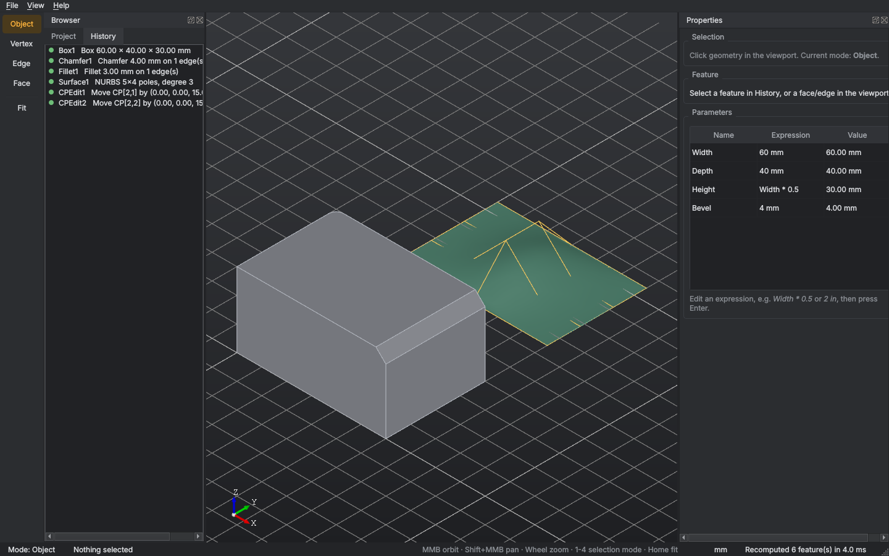
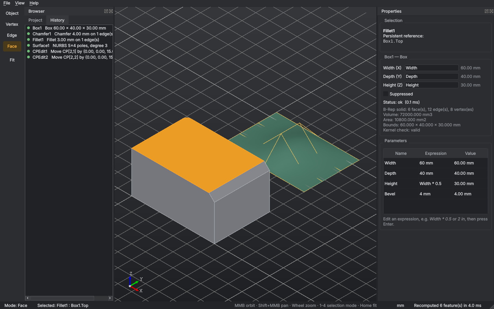
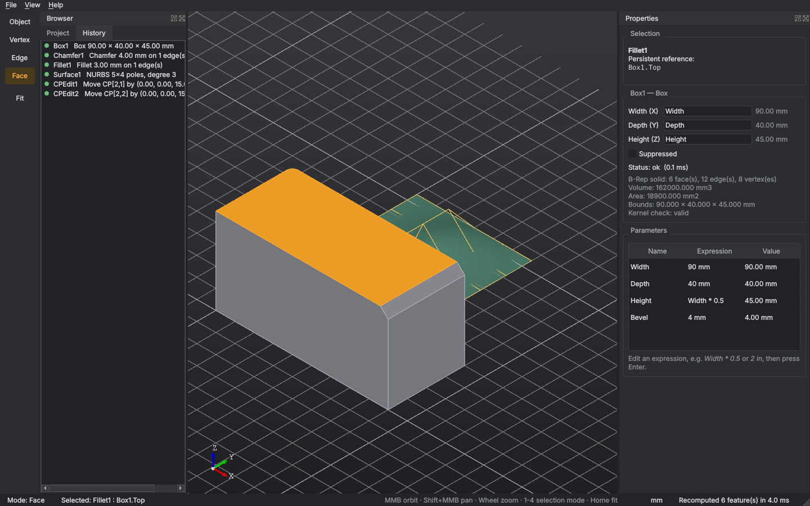
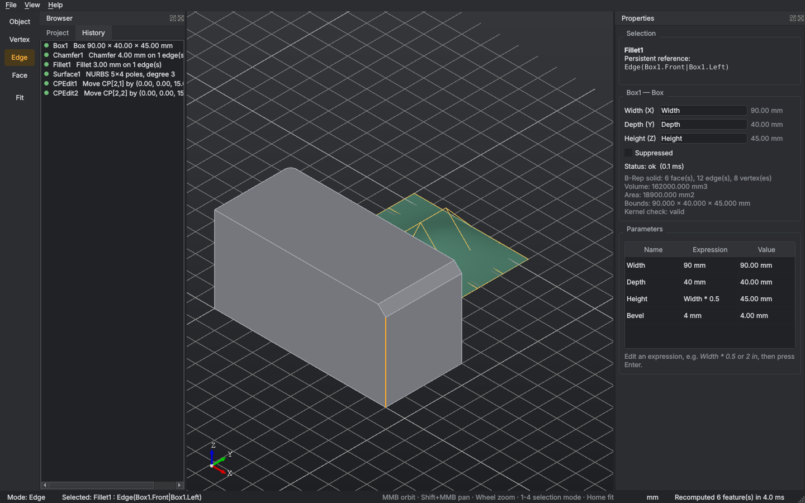
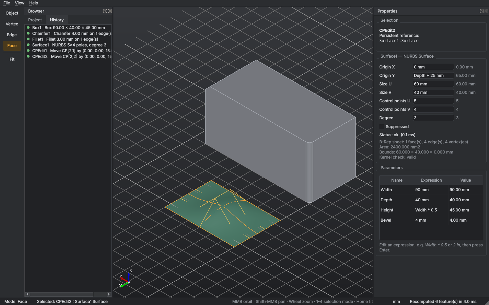
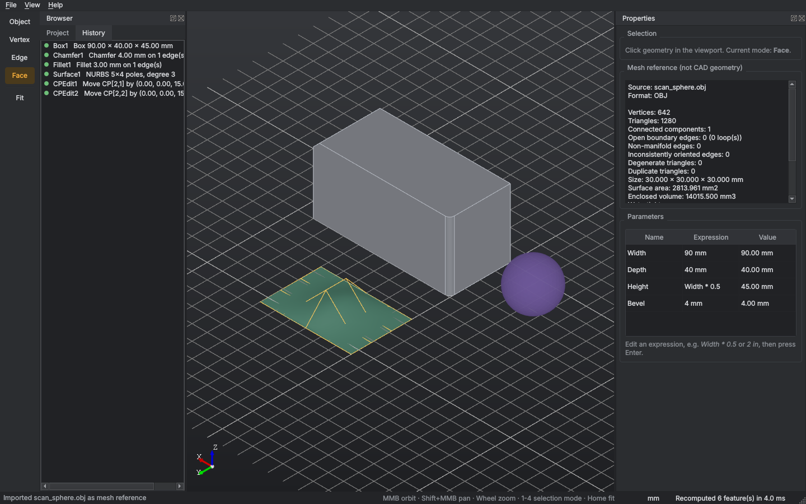

# Phase 0 Report — Architecture and Proof of Concept

Version: `0.0.1-phase0` · Date: 2026-11-27 · Status: **reviewed; Phase 1 approved** by the owner on 2026-11-27.

## 1. What was done

1. Inspected the repository (empty apart from a README) and the development
   environment (Linux container, GCC 13, CMake 3.28; OCCT 7.6.3 and Qt 6.4.2
   installed from Ubuntu packages).
2. Evaluated kernel, UI framework, solvers, NURBS, mesh-to-CAD, installer and
   updater options and licences → [TECH_DECISIONS.md](TECH_DECISIONS.md),
   [LICENCES.md](LICENCES.md).
3. Designed the document model, feature history, recompute and topological
   naming → [ARCHITECTURE.md](ARCHITECTURE.md).
4. Wrote all required documents (PRODUCT_BRIEF, ARCHITECTURE, TECH_DECISIONS,
   ROADMAP, LICENCES, TEST_STRATEGY, MESH_TO_CAD, NURBS_ARCHITECTURE, UX_DESIGN).
5. Built a genuine desktop proof of concept with tests and CI on Linux and
   Windows.

## 2. Selected stack

| Area | Choice |
|---|---|
| Geometry kernel | Open CASCADE Technology (7.9.x for Phase 1, 8.0.x evaluated at Phase 2 start) |
| UI | Qt 6 Widgets (6.8 LTS), OCCT V3d/AIS viewport |
| Language / build | C++20, CMake, MSVC 2022; vcpkg for release builds (Phase 1) |
| Parametric model | Own document model: expressions, features, persistent references, DAG recompute |
| Topological naming | Generator-role face names + history propagation + face-set edge/vertex references |
| NURBS | Editable definition in the document, rebuilt as `Geom_BSplineSurface`; control-point edits are history features |
| Sketch solver | PlaneGCS (LGPL) recommended; libslvs only if the product is GPL |
| Mesh-to-CAD | Own pipeline (RANSAC + region growing, quad remeshing, B-spline fitting) on permissive libraries + OCCT fitting/sewing |
| Installer / updater | Velopack (per-user install, delta updates, channels, rollback) |
| Native format | ZIP container: JSON document + optional BRep caches |

## 3. Proof of concept — requirement by requirement

| Brief requirement | Result | Evidence |
|---|---|---|
| 1. Real B-Rep box | ✔ `BRepPrimAPI_MakeBox`, 6 named faces, kernel-valid solid | `BoxFeature.CreatesValidBRepSolid` |
| 2. Display in a viewport | ✔ OCCT viewport in Qt window, shaded + edges, grid, axis triad | screenshots 01–06 |
| 3. Vertex, Edge and Face selection | ✔ plus Object mode; real OCCT picking, results shown as persistent references | UI smoke test steps 2, 4 |
| 4. Editable dimensions | ✔ named parameters with expressions and units (`Height = Width * 0.5`, `2 in`); feature fields editable | `ParameterTable.DrivenParameters`, UI |
| 5. Recalculation | ✔ history recompute (Box → Chamfer → Fillet; NURBS → 2 control point edits), suppression, rollback, error propagation | `History.*`, smoke step 3 |
| 6. Basic NURBS surface | ✔ degree-3, 5×4 poles, rational weights supported, control cage + points displayed, edits stored as features | `Nurbs.*`, screenshot 05 |
| 7. OBJ/STL import | ✔ STL ASCII/binary + OBJ, unit prompt, welding, analysis report, kept as reference (not CAD) | `MeshImport.*`, `MeshAnalysis.*`, screenshot 06 |
| Topological reference stability | ✔ chamfer stays on `Edge(Box1.Front|Box1.Top)` across width 60/120/25/300 mm; UI re-selects `Box1.Top` after edit | `TopoNaming.*`, smoke step 3 |

No fake polygon geometry: the box, chamfer, fillet and NURBS surface are OCCT
B-Rep; only the imported mesh is polygons, labelled as such.

## 4. Test results

| Platform | Build | Unit + geometry (32) | UI smoke (22 checks) |
|---|---|---|---|
| Linux, Ubuntu 24.04, GCC 13, OCCT 7.6.3, Qt 6.4.2 | ✔ | ✔ 32/32 | ✔ under Xvfb |
| Windows Server 2022 (GitHub runner), MSVC 2022, OCCT 7.9 + Qt 6.8 (conda-forge) | ✔ | ✔ 32/32 | ✔ exit code 0 with Mesa llvmpipe (no GPU on runner) |

CI: `.github/workflows/ci.yml`. Artifacts per run: Linux and Windows
screenshots, and a portable Windows folder `HybridCAD-PoC-windows-x64`
(64 MB unpacked, ~29 MB zipped).

## 5. Screenshots (real application)

| | |
|---|---|
|  Demo history |  Face selection → `Box1.Top` |
|  Width 60 → 90 mm, face re-selected |  Edge selection |
|  NURBS sheet with control cage |  OBJ reference mesh + analysis |

The viewport area in screenshots is OCCT's own offscreen render composited into
the Qt window grab (see TEST_STRATEGY §4).

## 6. Known limitations and bugs

- **No installer or updater yet** — by design these are Phase 1. Windows
  output is a portable folder from CI (unsigned).
- The PoC was built and run in a Linux container; the Windows build was
  compiled, tested and smoke-tested on a GitHub Windows runner with software
  OpenGL. It has **not been tried on a physical Windows PC with a GPU**.
- Recompute is linear and synchronous (DAG + background thread in Phase 2–5).
- No save/open, no undo/redo, no gizmo, no command palette (Phases 1–2).
- Toolbar is text-only; no icon set yet.
- NURBS control points are displayed but not selectable; editing via fields.
- Edge references between the same two faces (seams/split edges) are refused
  as ambiguous instead of disambiguated (planned).
- Reference meshes cannot be selected or moved in the viewport.
- On OCCT 7.6 sub-shape picking requires objects to be displayed with
  selection mode 0 first (workaround in `SceneSync`, documented).
- The face highlight on the NURBS sheet is subtle (outline only).

## 7. Major risks

Top risks (full register in TECH_DECISIONS.md): OCCT fillet/boolean robustness
(R1), topological naming in complex histories (R2), mesh-to-NURBS quality vs
expectations (R4), solver licensing depending on product licence (R5),
code-signing for installer/updater trust (R8), and overall scope (R10).

## 8. Owner decisions

Decided 2026-11-27: commercial closed-source product (no GPL dependencies),
name HybridCAD, Phase 1 scope approved as in ROADMAP.md.

Still open: code-signing certificate before public builds; update hosting
(GitHub Releases for alpha is the default).

## 9. Recommended next step

Approve Phase 0 (or request changes), decide item 1, then start Phase 1:
professional UI shell, icon set, command palette, onboarding, Velopack
installer `0.1.0-alpha` and a verified in-app update to `0.1.1-alpha`.
