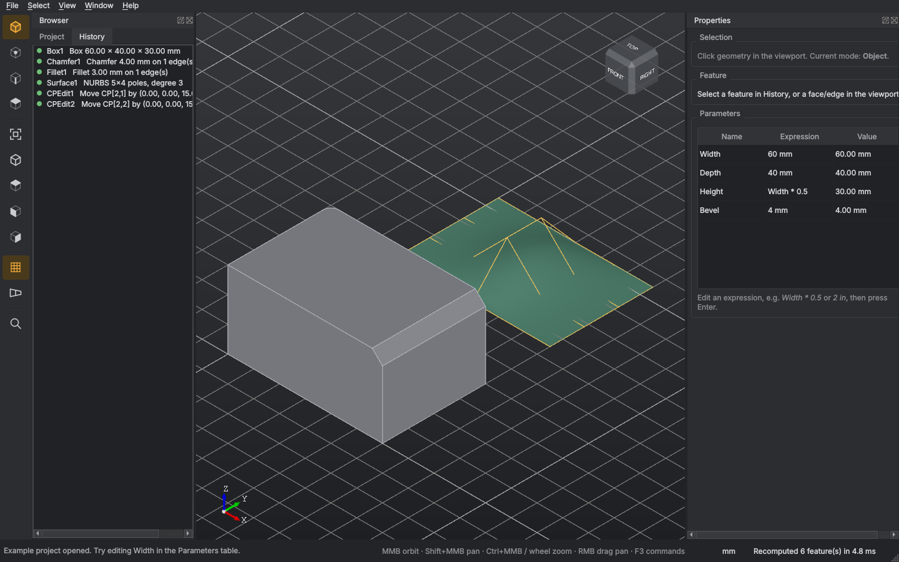
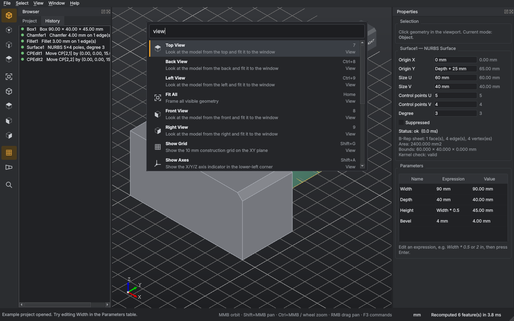
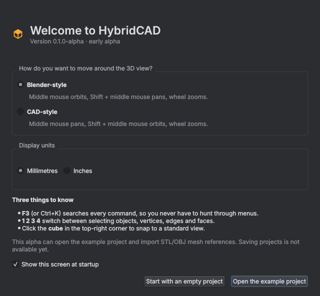
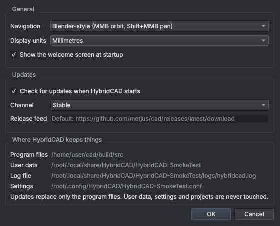

# Phase 1 report: UI foundation, installer, in-app updates

Version: **0.1.0-alpha** (plus 0.1.1-alpha, built by CI only to prove the
update path). Date: 2026-11-27. Branch: `claude/project-thread-9yonsn`.

HybridCAD is still not a usable CAD application. Phase 1 builds the frame the
modelling phases will plug into: how commands are found and run, how the
viewport is navigated, how a new user is welcomed, and how the program is
installed and updated without touching user data.

## 1. What was implemented

### Command-driven UI shell
- `CommandRegistry` (`src/app/CommandRegistry.*`): every user action is one
  command with id, name, description, category, shortcut, icon and optional
  enabled/checked state. Menus (File, Select, View, Window, Help), the left
  toolbar, tooltips (name + shortcut + description), the status-bar hints and
  the shortcut sheet are generated from it. 31 commands.
- Command palette (`F3` or `Ctrl+K`): fuzzy search over names, categories and
  descriptions, keyboard navigation, recently used commands first.
- Keyboard Shortcuts sheet (`Ctrl+F1`), generated from the registry.
- A test guarantees that every menu/toolbar item is a registered command with
  a description, every command is in a menu, and shortcuts are unique, so the
  UI cannot show decorative, unimplemented controls.

### Original icon set
- 27 icons drawn in code on a 24 px grid (`src/app/Icons.cpp`), no third-party
  artwork. Each icon has normal, hover, checked (amber accent) and disabled
  states at 1x and 2x resolution.

### Viewport
- Orientation cube (top right): clicking a face, edge or corner snaps to that
  view. It is never part of model selection.
- Seven standard views (iso `0`, top/front/right `7/8/9`, opposite sides with
  `Ctrl`), perspective/orthographic toggle (`5`), grid (`Shift+G`), axes
  indicator (`Shift+A`), cube (`Shift+C`), fit (`Home`).
- Navigation presets: **Blender-style** (middle mouse orbit, Shift+middle pan,
  Ctrl+middle zoom) and **CAD-style** (middle mouse pan, Shift+middle orbit).
  Wheel zoom and right-drag pan in both; Alt+left emulates the middle button.

### Onboarding and settings
- First-launch welcome: choose navigation style and units, three tips, then
  open the example project or start empty. Reopen via Help → Welcome Screen.
- Preferences (`Ctrl+,`): navigation, units, welcome at startup, update
  checks, channel (stable/beta), release feed, and where files are kept.
- Example project (`Ctrl+E`) and empty project (`Ctrl+N`, asks first, because
  saving is not available yet).

### Logging and data separation
- Log file `%LOCALAPPDATA%\HybridCAD\HybridCAD\logs\hybridcad.log`, rotated at
  2 MB, 3 old files kept; Help → Open Log Folder.
- Program files, user data, settings and projects live in separate places;
  see [UPDATES.md](UPDATES.md). Tests use their own settings scope.

### Installer and in-app updates (Velopack)
- `UpdateService` on the Velopack C API: check, download (delta when
  available) with progress, apply on restart. Builds without Velopack (Linux,
  developer builds) show "Updates unavailable in this build".
- Help → Check for Updates dialog; status-bar indicator when an update is
  available or ready; optional check at startup.
- Per-user installer `HybridCAD.App-stable-Setup.exe` (no admin rights).
- Executable renamed to `HybridCAD.exe`; version comes from CMake
  (`HCAD_VERSION_FULL`).

## 2. What works (verified)

CI_RESULTS_PLACEHOLDER

## 3. Tests

| Suite | Count | Where |
|---|---|---|
| Unit + geometry (core, mesh, kernel, document, fuzzy search) | 38 | Linux + Windows |
| UI unit tests (offscreen Qt) | 13 | Linux + Windows |
| UI smoke test (real window, OCCT picking, screenshots) | 1 script, 37 checks | Linux (blocking), Windows (Mesa, non-blocking) |
| Installer + update round trip | 1 script, 11 checks | Windows |

Local run (Ubuntu 24.04, OCCT 7.6.3, Qt 6.4.2): 52/52 tests passed,
smoke test passed.

## 4. Screenshots

| | |
|---|---|
|  |  |
| Main window, example project, view cube | Command palette (F3), query "view" |
|  |  |
| First-launch welcome | Preferences |

## 5. What is not finished / deviations from the plan

- **No saving or opening of projects** (Phase 2 as planned).
- **Not code-signed**: Windows SmartScreen warns when installing. Needs a
  code-signing certificate (owner decision).
- **No published release feed yet**: the default feed points at GitHub
  Releases of this repository, but nothing is published there; where
  production updates are hosted is an owner decision.
- **No user-triggered rollback** to the previous version. Velopack keeps the
  old version only if applying an update fails.
- **Planned but not done**: vcpkg manifest (conda-forge kept, works for CI),
  spdlog (Qt's logging is enough so far), crash handler with minidumps
  (moved to Phase 2), skippable in-viewport hints (the welcome tips and
  status-bar hints cover this for now).
- Not tested on a real GPU or a real user PC yet; CI uses software OpenGL.

## 6. Known issues

- On Windows CI the UI smoke test runs on Mesa software rendering and is
  marked non-blocking.
- Grid is a fixed 400 × 400 mm with 10 mm cells; it does not adapt to zoom.
- Clicking the view cube jumps to the view without animation.

## 7. How to build, install, update

See [README.md](../README.md) (build) and [UPDATES.md](UPDATES.md)
(installer, update flow, where data lives).

## 8. Next steps (Phase 2 proposal, needs approval)

1. Project files: save/open `.hcad`, autosave and crash recovery, recent files.
2. Undo/redo across parameter and feature edits.
3. Crash handler (minidumps) and a "send report" flow.
4. Publish the first real release to an HTTPS feed (after hosting decision)
   and sign the installer (after certificate decision).
5. First sketch-based modelling (sketch on a plane, extrude), building on the
   command registry.
